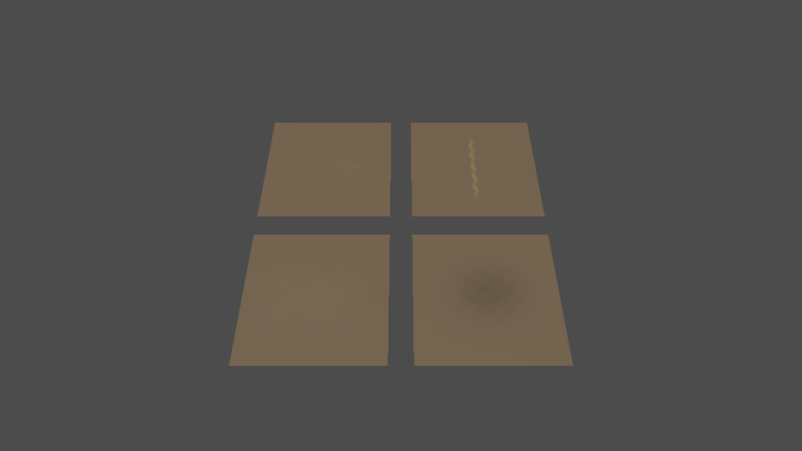
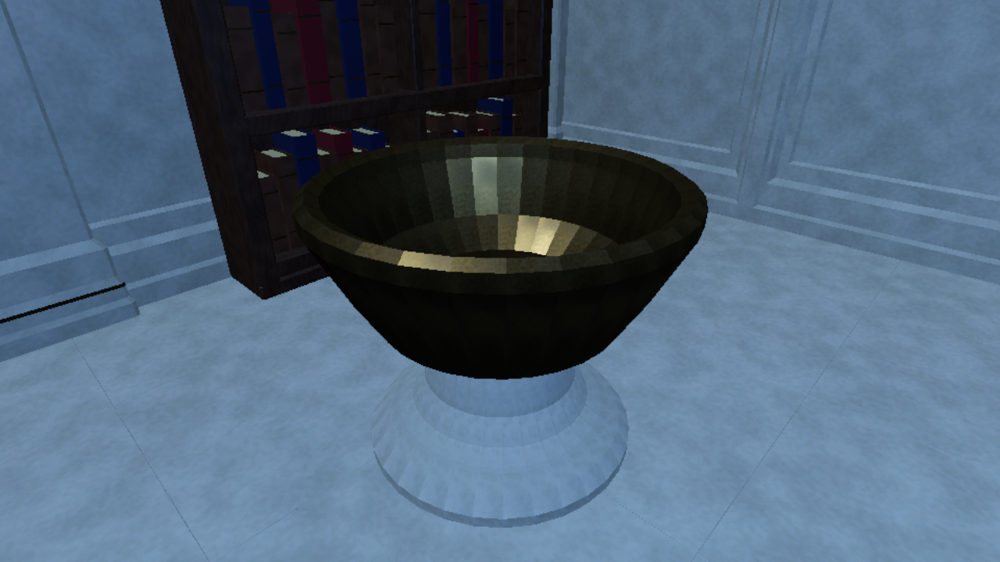
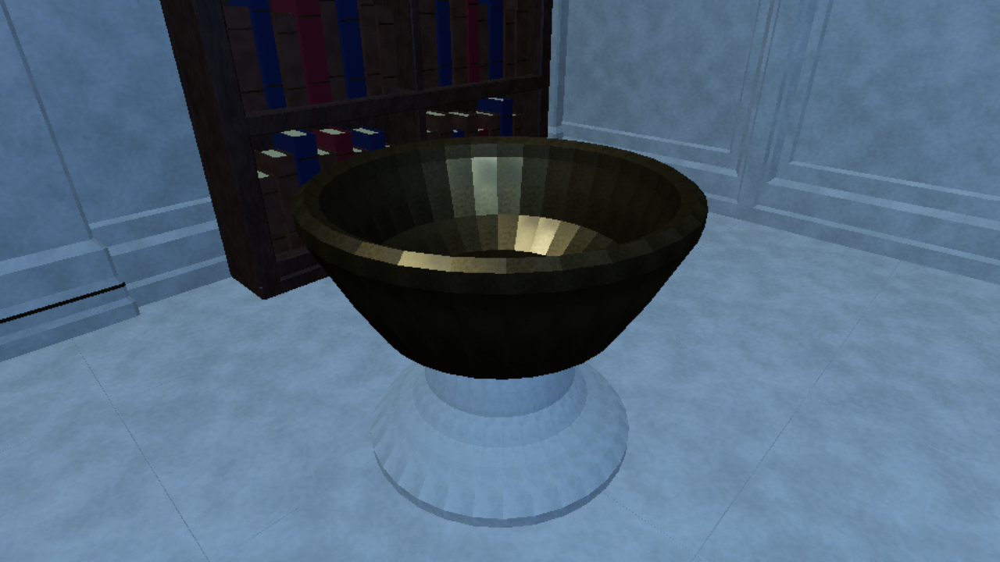
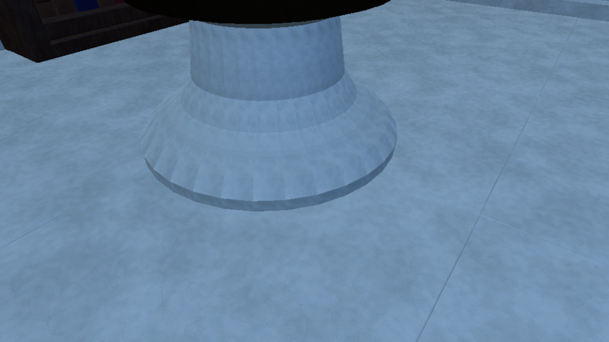
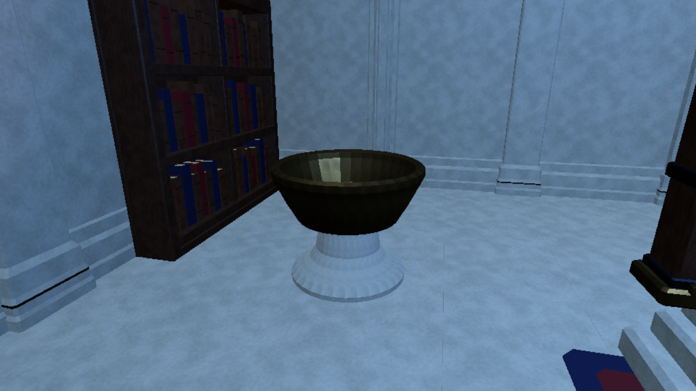
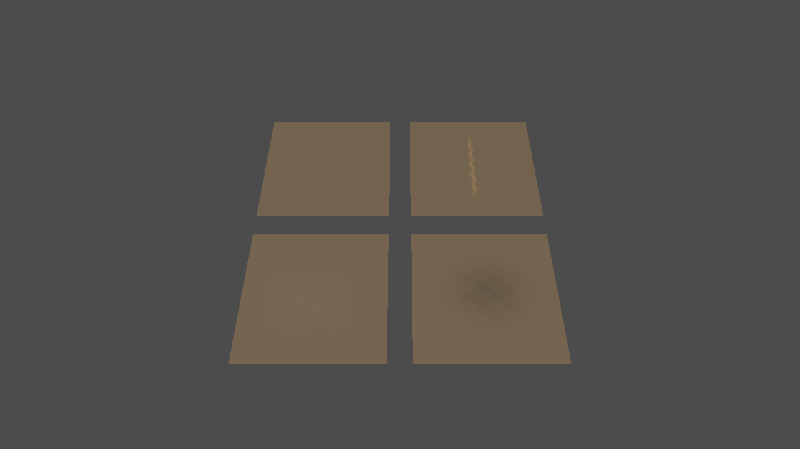
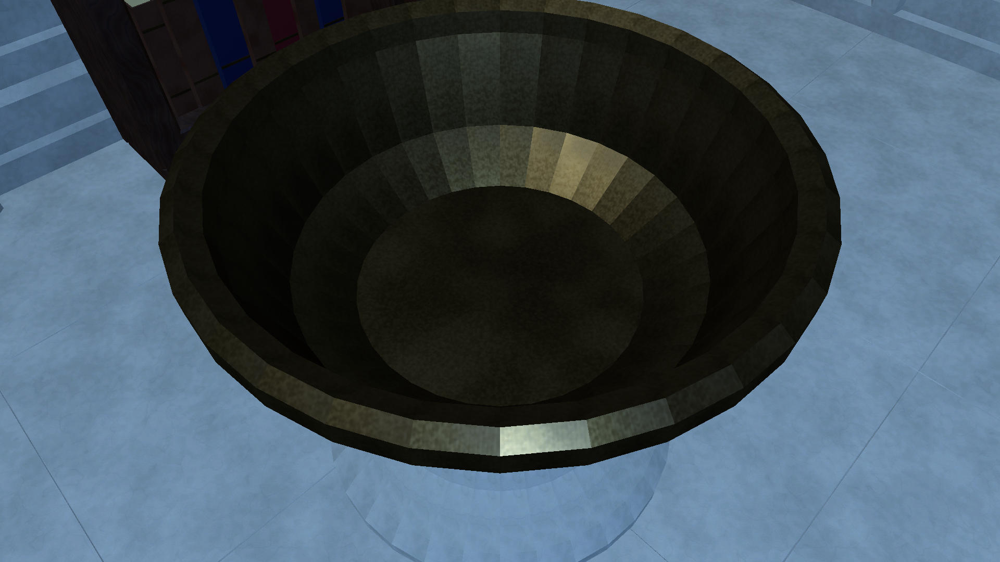

# Native surface decal review - 2026-11-02

All20 original frames individually inspected. Neutral four-mask fixtures and current S02 cold close/isolated/approach API poses at Low1280x720 and Medium1920x1080. Software Vulkan, not full gameplay or target hardware. The pale/cool unfinished room baseline is retained; full style is not approved by this local detail block.

## neutral_kit_on_low.png

Four original mask families are visible on neutral planes; the off frame retains clean planes. This is a neutral fixture, not shipping art/style.

## neutral_kit_off_low.png

Four original mask families are visible on neutral planes; the off frame retains clean planes. This is a neutral fixture, not shipping art/style.

## hearth_close_on_low.png

The two original projection volumes stay local to the existing bowl/pedestal. Same mesh, camera, light and room; restrained visible differences.

## hearth_close_off_low.png

The two original projection volumes stay local to the existing bowl/pedestal. Same mesh, camera, light and room; restrained visible differences.

## hearth_soot_on_low.png

Isolated soft soot is visible on the recessed bowl floor, without a hard texture rectangle or changed lip/room.

## hearth_soot_off_low.png

Isolated soft soot is visible on the recessed bowl floor, without a hard texture rectangle or changed lip/room.

## hearth_dust_on_low.png

Isolated dust stays on the pedestal bevel with feathered edges; adjacent room floor is unaffected.

## hearth_dust_off_low.png

Isolated dust stays on the pedestal bevel with feathered edges; adjacent room floor is unaffected.

## hearth_approach_on_low.png

Existing approach and bowl silhouette remain clear; surface change is sparse and secondary. Room/lighting/full style remain incomplete.

## hearth_approach_off_low.png

Existing approach and bowl silhouette remain clear; surface change is sparse and secondary. Room/lighting/full style remain incomplete.

## neutral_kit_on_medium.png

Four original mask families are visible on neutral planes; the off frame retains clean planes. This is a neutral fixture, not shipping art/style.

## neutral_kit_off_medium.png

Four original mask families are visible on neutral planes; the off frame retains clean planes. This is a neutral fixture, not shipping art/style.

## hearth_close_on_medium.png

The two original projection volumes stay local to the existing bowl/pedestal. Same mesh, camera, light and room; restrained visible differences.

## hearth_close_off_medium.png

The two original projection volumes stay local to the existing bowl/pedestal. Same mesh, camera, light and room; restrained visible differences.

## hearth_soot_on_medium.png

Isolated soft soot is visible on the recessed bowl floor, without a hard texture rectangle or changed lip/room.

## hearth_soot_off_medium.png

Isolated soft soot is visible on the recessed bowl floor, without a hard texture rectangle or changed lip/room.

## hearth_dust_on_medium.png

Isolated dust stays on the pedestal bevel with feathered edges; adjacent room floor is unaffected.

## hearth_dust_off_medium.png

Isolated dust stays on the pedestal bevel with feathered edges; adjacent room floor is unaffected.

## hearth_approach_on_medium.png

Existing approach and bowl silhouette remain clear; surface change is sparse and secondary. Room/lighting/full style remain incomplete.

## hearth_approach_off_medium.png

Existing approach and bowl silhouette remain clear; surface change is sparse and secondary. Room/lighting/full style remain incomplete.

