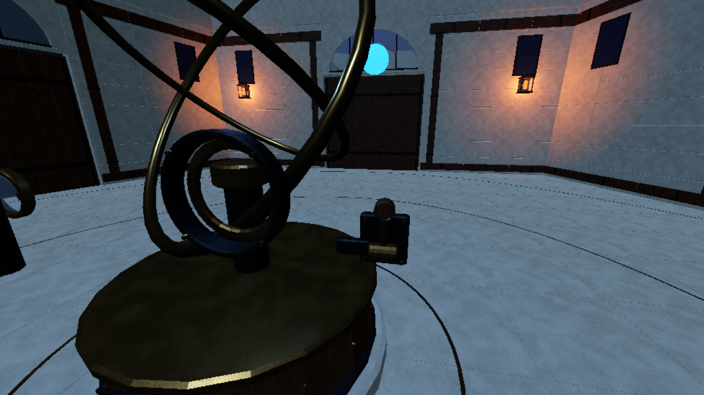
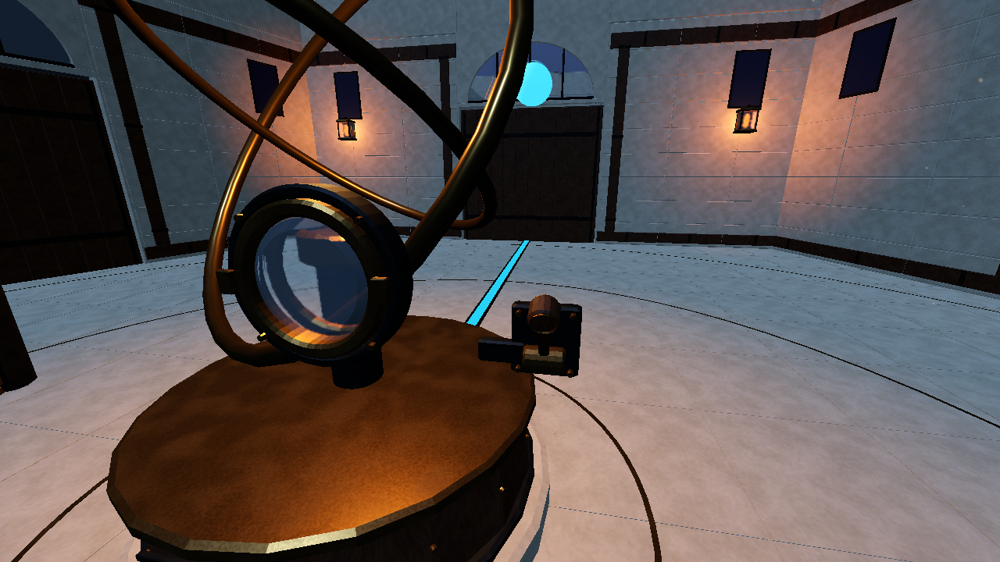
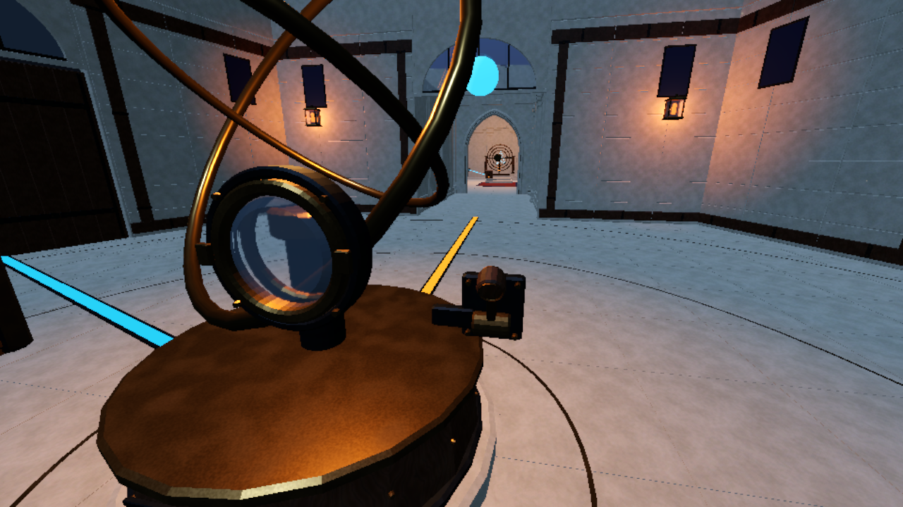
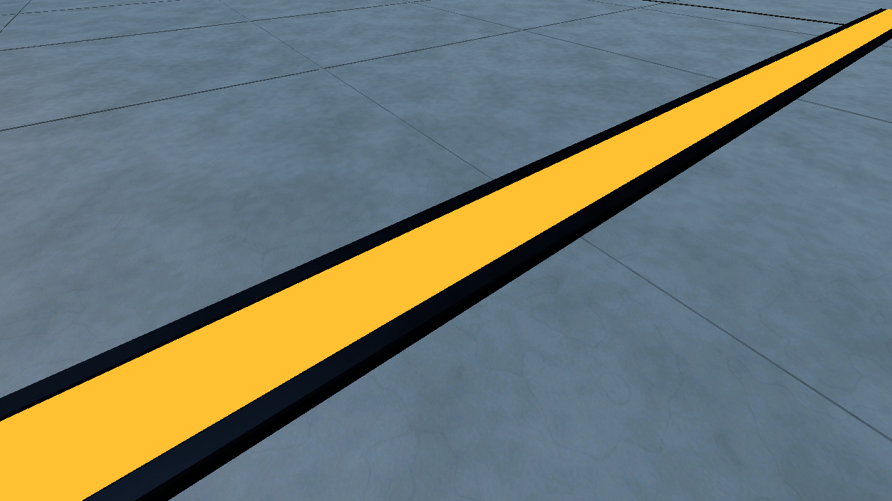

# Archive channel trim - native review, 2026-10-31

Original 1280x720 current-world captures, software Vulkan Forward+. Three quiet player-camera projections and one supplemental close-up per profile. This is bounded channel presentation evidence, not full Hub/style/target-GPU acceptance.

28 component checks and cache-free import pass. Low render scale 0.75; Medium 1.0. Both actual profiles have glow/volumetrics off. No original image has been altered.

## Dormant: all channels hidden

| Low | Medium |
| --- | --- |
|  |  |

## Active: Wing I cyan

| Low | Medium |
| --- | --- |
|  |  |

## Completed: Wing I gold, Wing II cyan

| Low | Medium |
| --- | --- |
|  |  |

## Supplemental frame detail

| Low | Medium |
| --- | --- |
|  |  |

The central mechanism partially occludes the near channel in the player framing. ARCH-015 and S01-005 remain PARTIAL; see [bounded acceptance](../ARCHIVE_CHANNEL_TRIM_V1.md).
