# Native fragment glyph VFX review - 2026-11-02

All30 originals below were individually inspected. Low1280x720 and Medium1920x1080 are native software Vulkan captures of the current modal API and deterministic Tween samples on a flat background. No gameplay route, world carrier, style or target GPU acceptance. Attempt4 alone receives final credit.

## star_reveal_zero_low_1280x720.png

Only glyph absent; title, couplet, feeling and Continue are fully readable.

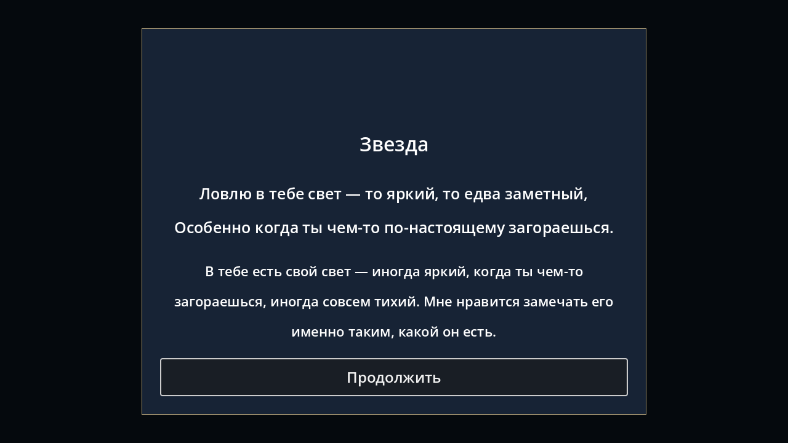

## star_reveal_half_low_1280x720.png

Partial glyph with bounded cell edge; text/panel stable.

## star_reveal_paused_low_1280x720.png

Same partial glyph as reveal_half; native exact frame identity passes.

## star_settled_low_1280x720.png

Complete original glyph; original modal layout and Cyrillic fit.

## star_shader_one_low_1280x720.png

Visually identical complete glyph; exact native raster equality passes.

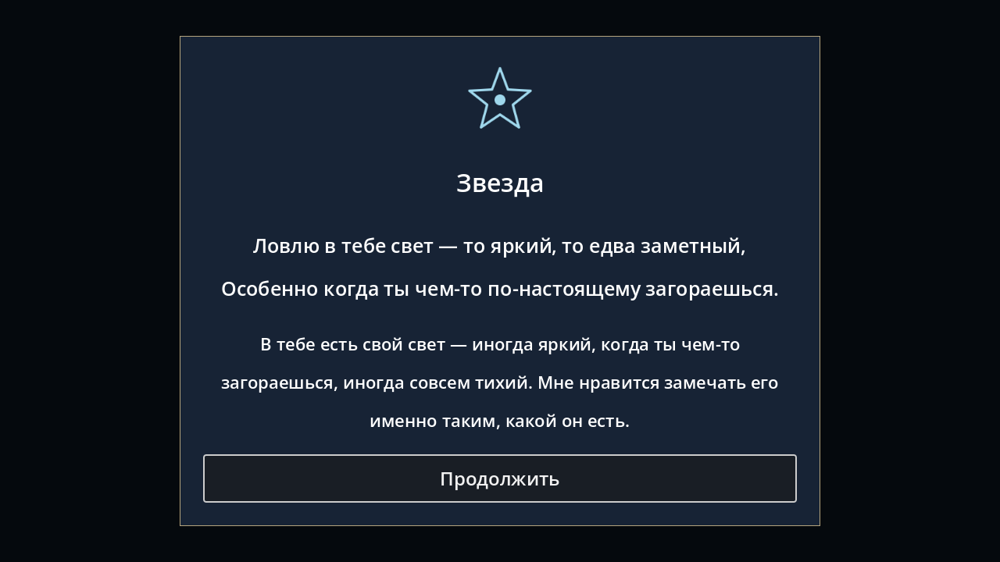

## star_dissolve_half_low_1280x720.png

Same original glyph size/position on the flat fixture background; modal already closed.

## star_dissolve_finished_low_1280x720.png

Only the flat background remains, with no ghost quad.

## hearth_reveal_zero_low_1280x720.png

Only glyph absent; title, couplet, feeling and Continue are fully readable.

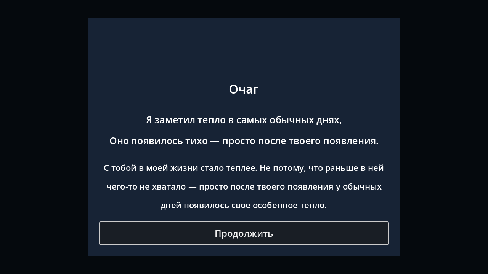

## hearth_reveal_half_low_1280x720.png

Partial glyph with bounded cell edge; text/panel stable.

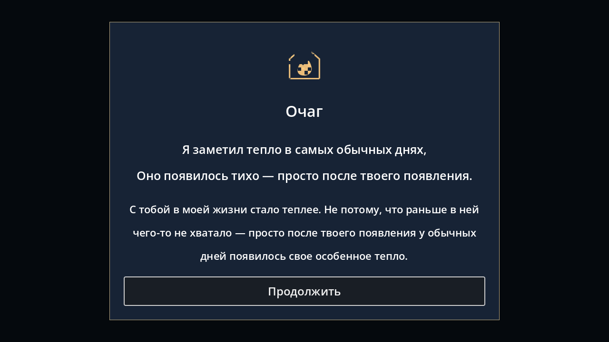

## hearth_reveal_paused_low_1280x720.png

Same partial glyph as reveal_half; native exact frame identity passes.

## hearth_settled_low_1280x720.png

Complete original glyph; original modal layout and Cyrillic fit.

## hearth_shader_one_low_1280x720.png

Visually identical complete glyph; exact native raster equality passes.

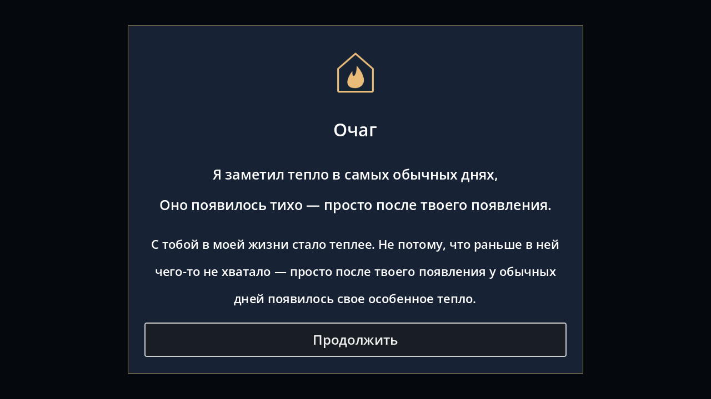

## hearth_dissolve_half_low_1280x720.png

Same original glyph size/position on the flat fixture background; modal already closed.

## hearth_dissolve_finished_low_1280x720.png

Only the flat background remains, with no ghost quad.

## star_effects_off_low_1280x720.png

Immediate complete original Star, no effect or extra quad.

## star_reveal_zero_medium_1920x1080.png

Only glyph absent; title, couplet, feeling and Continue are fully readable.

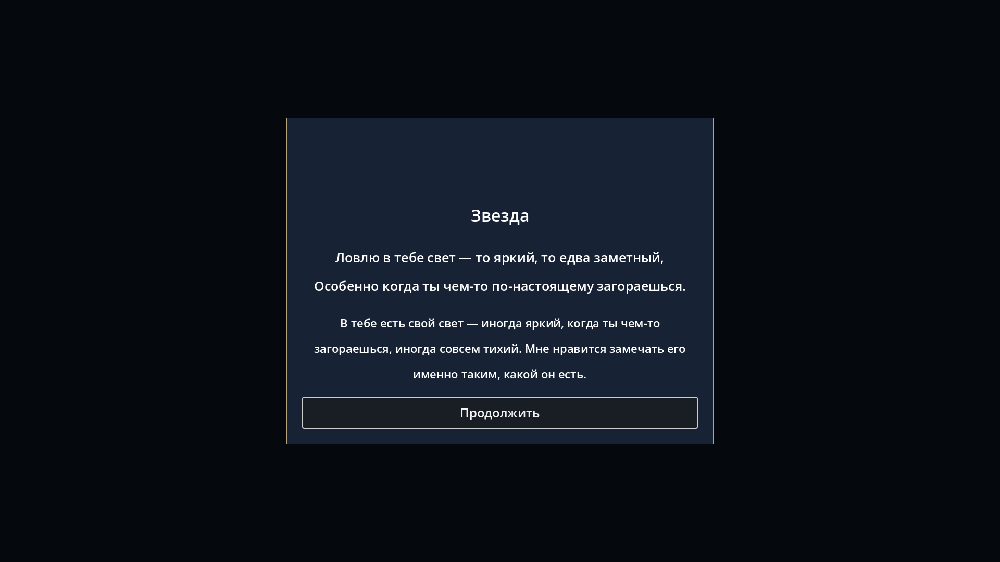

## star_reveal_half_medium_1920x1080.png

Partial glyph with bounded cell edge; text/panel stable.

## star_reveal_paused_medium_1920x1080.png

Same partial glyph as reveal_half; native exact frame identity passes.

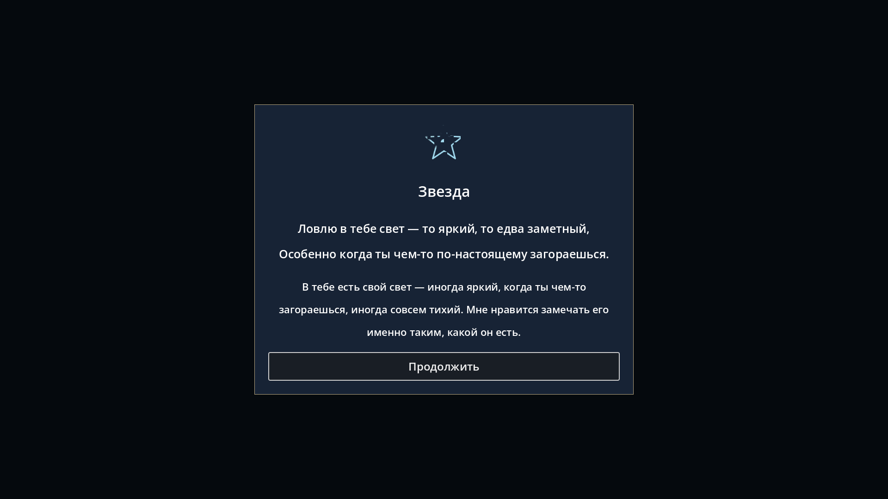

## star_settled_medium_1920x1080.png

Complete original glyph; original modal layout and Cyrillic fit.

## star_shader_one_medium_1920x1080.png

Visually identical complete glyph; exact native raster equality passes.

## star_dissolve_half_medium_1920x1080.png

Same original glyph size/position on the flat fixture background; modal already closed.

## star_dissolve_finished_medium_1920x1080.png

Only the flat background remains, with no ghost quad.

## hearth_reveal_zero_medium_1920x1080.png

Only glyph absent; title, couplet, feeling and Continue are fully readable.

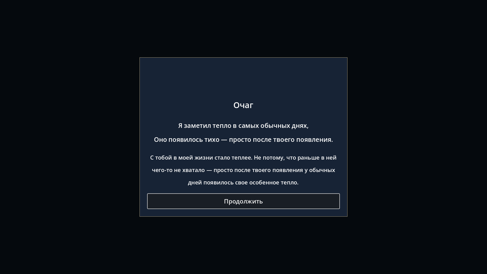

## hearth_reveal_half_medium_1920x1080.png

Partial glyph with bounded cell edge; text/panel stable.

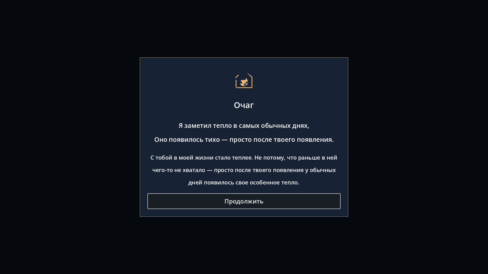

## hearth_reveal_paused_medium_1920x1080.png

Same partial glyph as reveal_half; native exact frame identity passes.

## hearth_settled_medium_1920x1080.png

Complete original glyph; original modal layout and Cyrillic fit.

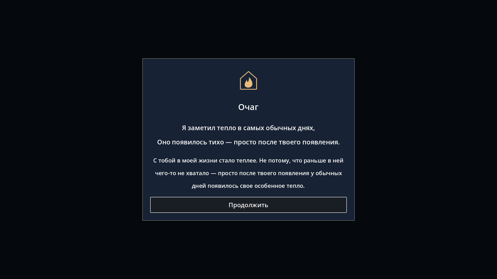

## hearth_shader_one_medium_1920x1080.png

Visually identical complete glyph; exact native raster equality passes.

## hearth_dissolve_half_medium_1920x1080.png

Same original glyph size/position on the flat fixture background; modal already closed.

## hearth_dissolve_finished_medium_1920x1080.png

Only the flat background remains, with no ghost quad.

## star_effects_off_medium_1920x1080.png

Immediate complete original Star, no effect or extra quad.

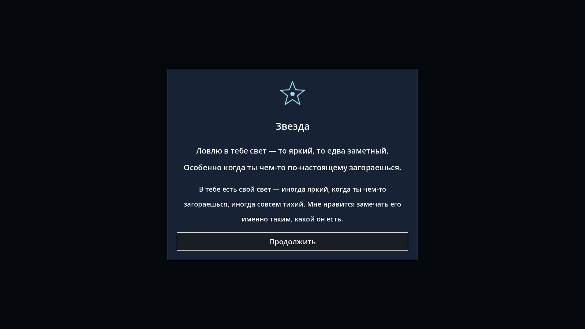
